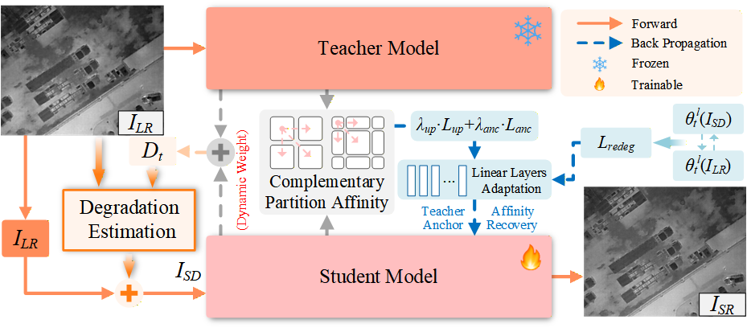
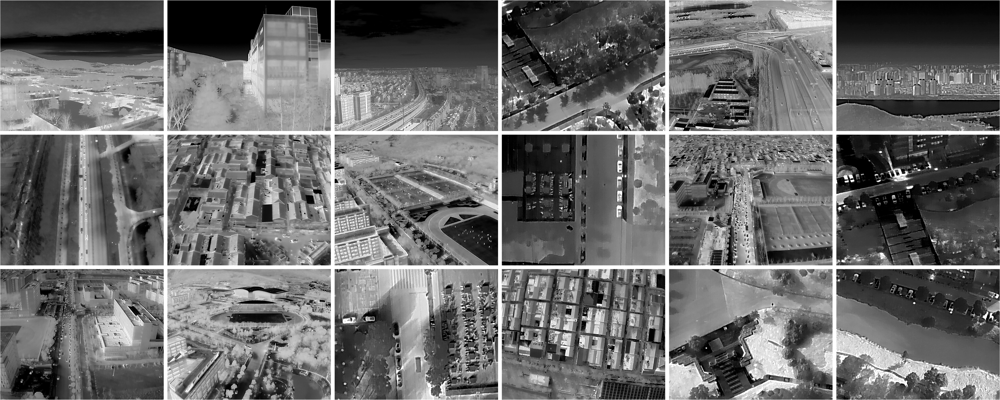

# ReCoRe: Test Time Adaptation for Infrared Image Super-Resolution with Region-Affinity Consistency Recovery



Implementation of **ReCoRe**, a test-time adaptation (TTA) framework for infrared image super-resolution (IRSR) under unknown, mixed real-world degradations. 

##### Language: English | [Chinese](README_zh.md)

> **Abstract.** Real-world infrared image super-resolution suffers from unknown and mixed degradations (noise, blur, thermal diffusion, non-uniform response, etc.) that deviate from the source training distribution and degrade the reconstruction quality of a fixed source model. We propose ReCoRe, a test-time adaptation framework that adapts a Mamba-based IRSR backbone to each test image **without paired HR supervision and without modifying the pretrained backbone structure**, by fine-tuning only a small set of linear layers. First, a *dynamic teacher–student reference* fuses the frozen teacher and student outputs with a dynamically updated weight to build a stable reference image. Second, a frozen *paired relative-degradation estimator* predicts the relative degradation (multi-label activations, continuous parameters, and confidence) between the reference and the observation; after a *safe projection* that removes irreversible components, retained differentiable operators construct a same-scale harder view. Third, a *teacher-anchored region-affinity recovery* compares teacher/student region affinities under complementary dual grids and, with a reliable gating mechanism, selectively strengthens only reliable, content-compatible neighbor relations. Extensive experiments on full-reference (Result-A / Result-C) and no-reference (Drone Vehicle / DJIThermalSR) benchmarks demonstrate consistent improvements over state-of-the-art TTA methods.

## Requirements

- Python 3.8+, PyTorch 2.1.0, CUDA 11.8 
- `mamba-ssm==1.0.1` for the accelerated `SS2D` selective scan
- `numpy scipy opencv-python imageio tqdm pandas` (see [requirements.txt](requirements.txt))
- Optional: `pyiqa` for the MANIQA no-reference metric

## Installation

```shell
cd ReCoRe-main
pip install -r requirements.txt
```

## Dataset Contribution

We contribute **DJIThermalSR**, a new self-collected real-world dataset for infrared SR, captured with the thermal camera (640×512@30fps) of a DJI drone. It contains 5,457 frames extracted from 13 videos collected over six months, spanning 5 weather conditions (day / night / dusk / fog / snow) × 5 scene types (road / street / ground / square / vegetation). 



Full dataset will be made available for download after the paper is accepted.

All images are converted to single-channel `[0,1]` on loading. Paired LR–HR images are matched by filename stem (optionally stripping an `x{scale}` suffix).

## Training

### 1. Pretrain the backbone (source model f_θ0)

```shell
cd ReCoRe-main
python -m src.backbone.train --dataroot <M3FD_dir> --scale 2 --save_dir checkpoints/backbone_x2
python -m src.backbone.train --dataroot <M3FD_dir> --scale 4 --save_dir checkpoints/backbone_x4
```

### 2. Pretrain the paired relative-degradation estimator E_φ

```shell
cd ReCoRe-main
python -m src.estimator.train --img_dir <M3FD_dir> --save_dir checkpoints/estimator --calibrate
# smoke test without data (random smooth synthetic scenes):
python -m src.estimator.train --length 200 --epochs 2 --batch_size 4
```

## Test-Time Adaptation

Put the checkpoints under `checkpoints/` and run `main_tta.py`.

### Full-reference (Result-A / Result-C)

With `--hr_dir`, PSNR / SSIM / GMSD are reported per image and averaged over the dataset:

```shell
cd ReCoRe-main
python main_tta.py --scale 2 \
    --lr_dir <LR_dir> --hr_dir <HR_dir> \
    --backbone_ckpt checkpoints/VanillaMamba_x2.pth \
    --estimator_ckpt checkpoints/estimator/estimator_final.pt \
    --save_dir results/recore_x2
# or via the shell scripts (edit the paths first):
bash scripts/tta_x2.sh   # for x2 scale
bash scripts/tta_x4.sh   # for x4 scale
```

### No-reference (Drone Vehicle / DJIThermalSR)

```shell
python main_tta.py --scale 2 --lr_dir <LR_dir> \
    --backbone_ckpt checkpoints/VanillaMamba_x2.pth \
    --estimator_ckpt checkpoints/estimator/estimator_final.pt \
    --metrics niqe,maniqa
```

### No-adaptation baseline

```shell
python main_tta.py --scale 2 --lr_dir <LR_dir> --backbone_ckpt checkpoints/VanillaMamba_x2.pth --no_tta
```

`main_tta.py` also supports `--warmup` / `--timeit` for per-image end-to-end GPU-time measurement. The `configs/*.yaml` files are reference documents for the hyper-parameters; the entry scripts use argparse defaults that mirror them.

## Unit Tests

```shell
cd ReCoRe-main
python tests/test_degradation.py
python tests/test_estimator.py
python tests/test_backbone.py
python tests/test_affinity.py
```


