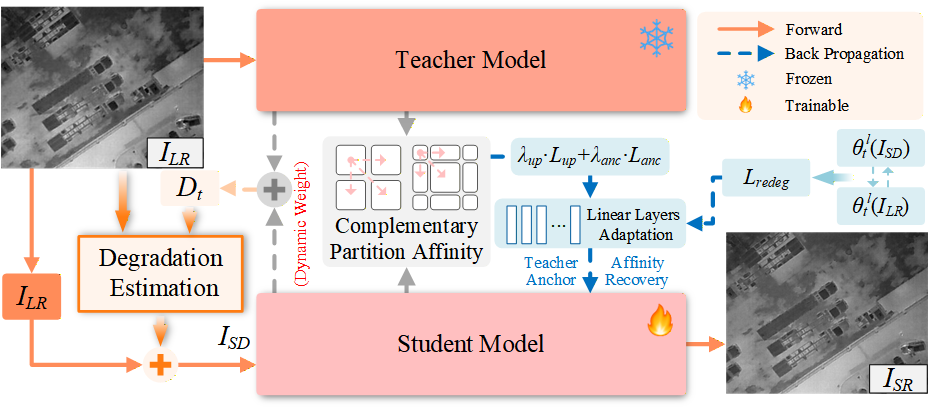
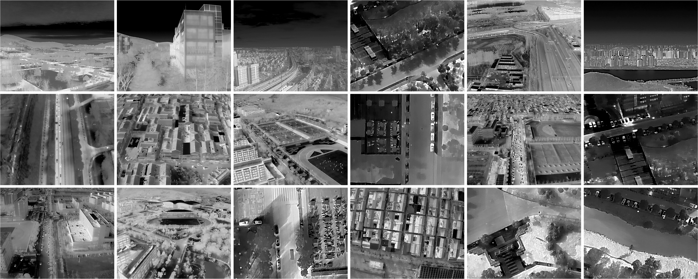

# ReCoRe: Test Time Adaptation for Infrared Image Super-Resolution with Region-Affinity Consistency Recovery



**ReCoRe** ：面向未知、混合真实退化的红外图像超分辨率（IRSR）测试时自适应（Test-Time Adaptation, TTA）框架。

##### 语言：中文 | [英文](README.md)

> **摘要**：真实世界红外图像超分面临未知且混合的退化（噪声、模糊、热扩散、非均匀响应等），与源训练分布发生偏移，导致固定源模型的重建质量下降。我们提出 ReCoRe，一个测试时自适应框架，在**不使用成对 HR 监督、不修改预训练 backbone 结构**的前提下，仅微调少量线性层，将 Mamba 系红外超分骨干逐图自适应到每张测试图。首先，*动态 Teacher–Student 参考*以动态更新的权重融合冻结 teacher 与 student 输出，构造稳定的参考图；其次，冻结的*成对相对退化估计器*预测参考图与观测图之间的相对退化（多标签激活、连续参数与置信度），经*安全投影*剔除不可逆分量后，由 retain 算子构造同尺度的"更难视图"；第三，*教师锚定的区域亲和性恢复*在互补双网格下比较 teacher/student 的区域亲和性，并通过可靠门控机制只选择性强化"可靠、内容相容"的邻接关系。在全参考（Result-A / Result-C）与无参考（Drone Vehicle / DJIThermalSR）基准上的大量实验表明，ReCoRe 相比现有 TTA 方法取得了一致的提升。

## 环境

- Python 3.8+ / PyTorch 2.1.0 + CUDA 11.8
- `mamba-ssm==1.0.1` `SS2D` 硬加速
- `numpy scipy opencv-python imageio tqdm pandas`（详见 [requirements.txt](requirements.txt)）
- 可选：`pyiqa`

## 安装

```shell
cd ReCoRe-main
pip install -r requirements.txt
```

## 数据集贡献

我们贡献了自建的真实世界红外超分辨率数据集**DJIThermalSR**，由大疆无人机的红外相机（640×512@30fps）采集。数据集包含 13 段视频、历时 6 个月 采集得到的 5457 帧 图像，覆盖 5 种天气（白天/夜晚/黄昏/雾/雪）× 5 类场景（道路/街道/地面/广场/植被）。



数据集将在论文录用后开放下载

加载时所有图像统一转为单通道 `[0,1]`；成对 LR–HR 按文件名 stem 匹配（可自动剥离 `x{scale}` 后缀）。

## 训练

### 1. 预训练 backbone

```shell
cd ReCoRe-main
python -m src.backbone.train --dataroot <M3FD目录> --scale 2 --save_dir checkpoints/backbone_x2
python -m src.backbone.train --dataroot <M3FD目录> --scale 4 --save_dir checkpoints/backbone_x4
```

### 2. 预训练成对相对退化估计器

```shell
cd ReCoRe-main
python -m src.estimator.train --img_dir <M3FD路径> --save_dir checkpoints/estimator --calibrate
# 无数据冒烟（随机平滑合成场景）：
python -m src.estimator.train --length 200 --epochs 2 --batch_size 4
```

## 测试时自适应

将权重放入 `checkpoints/` 后运行 `main_tta.py`。

### 全参考（Result-A / Result-C）

提供 `--hr_dir` 时逐图输出并在整个数据集上平均 PSNR / SSIM / GMSD：

```shell
cd ReCoRe-main
python main_tta.py --scale 2 \
    --lr_dir <LR目录> --hr_dir <HR目录> \
    --backbone_ckpt checkpoints/VanillaMamba_x2.pth \
    --estimator_ckpt checkpoints/estimator/estimator_final.pt \
    --save_dir results/recore_x2
# 或使用脚本（请先替换其中的路径）：
bash scripts/tta_x2.sh   # x2
bash scripts/tta_x4.sh   # x4
```

### 无参考（Drone Vehicle / DJIThermalSR）

```shell
python main_tta.py --scale 2 --lr_dir <LR目录> \
    --backbone_ckpt checkpoints/VanillaMamba_x2.pth \
    --estimator_ckpt checkpoints/estimator/estimator_final.pt \
    --metrics niqe,maniqa
```

### 仅重建基线（不自适应）

```shell
python main_tta.py --scale 2 --lr_dir <LR目录> --backbone_ckpt checkpoints/VanillaMamba_x2.pth --no_tta
```

`main_tta.py` 另支持 `--warmup` / `--timeit` 统计单图端到端 GPU 时间。`configs/*.yaml` 为超参参考文档；入口脚本使用与之对齐的 argparse 默认值。

## 单元测试

```shell
cd ReCoRe-main
python tests/test_degradation.py
python tests/test_estimator.py
python tests/test_backbone.py
python tests/test_affinity.py
```

